<div align="center">

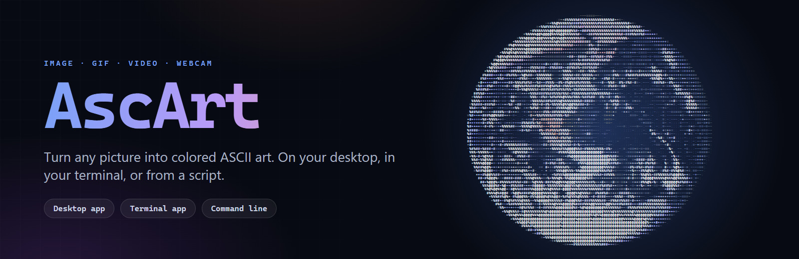

<br>

[](https://github.com/Oblutack/AscArt/actions/workflows/ci.yml)
[](LICENSE)


**[The desktop app](#the-desktop-app)** &nbsp;·&nbsp; **[The terminal app](#the-terminal-app)** &nbsp;·&nbsp; **[The command line](#the-command-line)** &nbsp;·&nbsp; **[Install](#install)** &nbsp;·&nbsp; **[How it works](#how-it-works)**

</div>

<br>

AscArt turns pictures, animated GIFs, short videos and your webcam into colored ASCII art. Use it as a desktop app with live preview, as an interactive app inside your terminal, or as a command you can script. Everything runs on your own machine.

<div align="center">
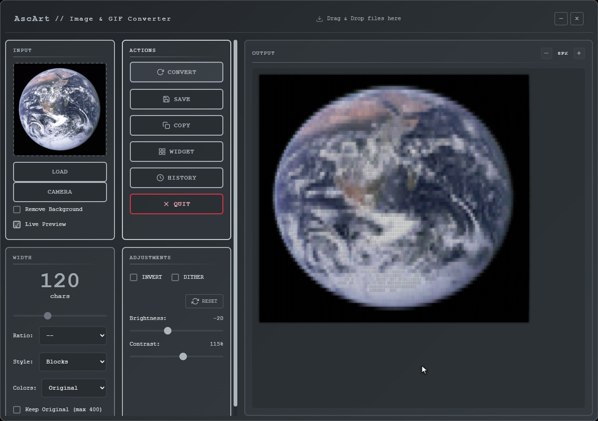
</div>

<br>

## Three ways to use it

|  | **Desktop app** | **Terminal app** | **Command line** |
| --- | --- | --- | --- |
| **Start it with** | the installer, or `npm start` | `ascart` | `ascart convert photo.jpg` |
| **Best for** | trying settings with a live preview, saving, widgets | the same thing without leaving your terminal | scripts, pipes, batch jobs |
| **Built with** | Electron, React, Python | Go, Bubble Tea | Go |
| **Needs** | nothing when installed (Python 3.12 to run from source) | nothing: one file of about 4 MB | nothing: the same file |

The terminal app and the command line are one program, `ascart`.

<br>

## The desktop app

<div align="center">
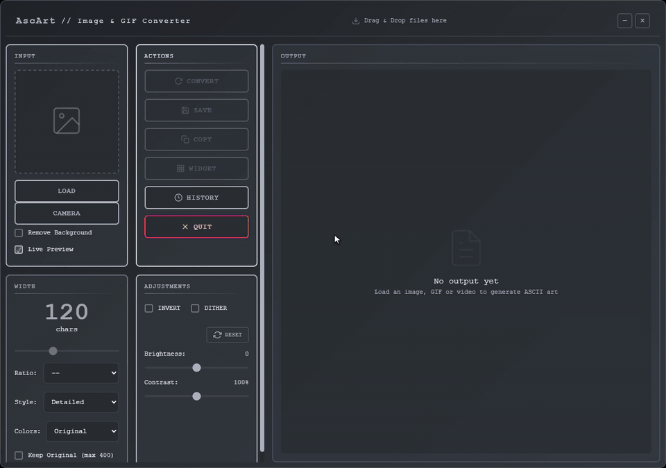
</div>

Load a picture (or drop one anywhere in the window) and the art appears straight away. Move a slider and it follows, with no button to press. The 8 color schemes, the character sets, brightness, contrast, invert and halftone are all live.

**Convert**

* **Pictures** in any common format, **animated GIFs** with their original timing, **short videos** (mp4, mov, webm, mkv, avi; needs [ffmpeg](https://ffmpeg.org/download.html)) and your **webcam**, live. Camera pictures are converted on your machine and never stored or sent anywhere.
* **Background removal** with AI segmentation: transparent pixels become spaces.
* **Character sets**: detailed, blocks, or your own ramp from darkest to lightest.
* **Halftone**: black and white Floyd–Steinberg dithering drawn with block characters.

**Save and share**

* Save as **HTML** (full color; GIFs become a self-contained animated page), **plain text**, **`.ans`** (24-bit terminal colors: `cat` it in a terminal), **PNG** or an animated **GIF**.
* **Copy** puts the plain characters on the clipboard.
* A **history gallery** keeps your last 50 conversions with their settings, so you can reopen and tweak them.
* **Desktop widgets**: pin the art or an animation to your desktop as a floating, draggable window.

**Keyboard**: `Ctrl+O` open, `Ctrl+Enter` convert, `Ctrl+S` save, `Ctrl+H` history, `Esc` stop a running conversion.

<br>

<div align="center">
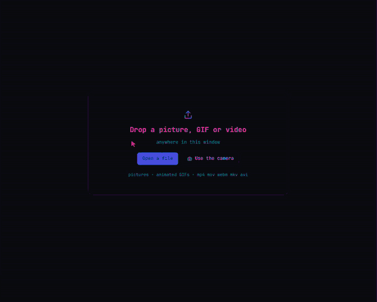
</div>

<p align="center"><sub>Animations play with their own timing. Zoom, change the speed, pause, or step frame by frame.</sub></p>

<table>
<tr>
<td width="50%" align="center">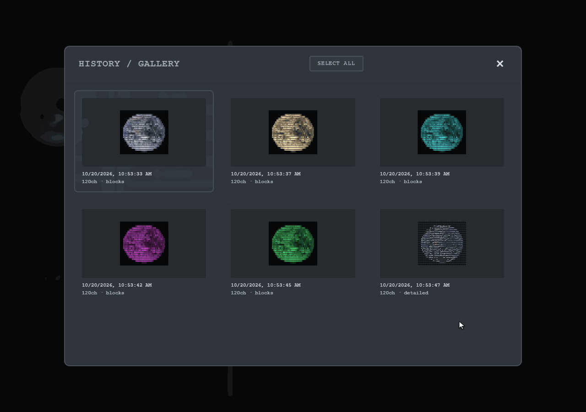<br><sub><b>History gallery</b>: every conversion, with its settings</sub></td>
<td width="50%" align="center">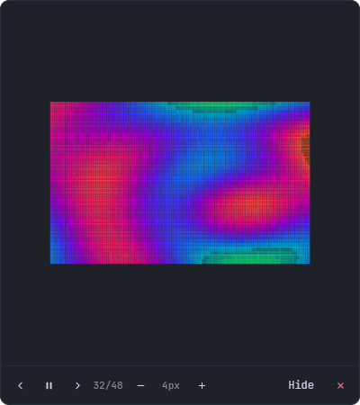<br><sub><b>Desktop widget</b>: art on your desktop, animations included</sub></td>
</tr>
</table>

<br>

## The terminal app

Run `ascart` with no arguments. Settings are on the left, the art on the right, and the art follows as you change them.

<div align="center">
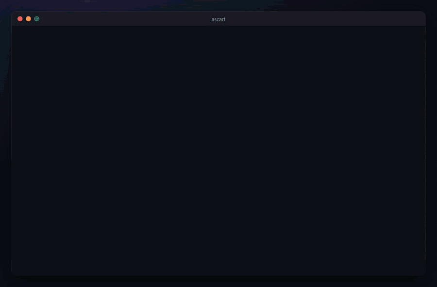
</div>

<p align="center"><sub>Character set, all eight color schemes, a typed width, halftone and the original picture.</sub></p>

It plays GIFs and videos too, with pause and frame stepping:

<div align="center">
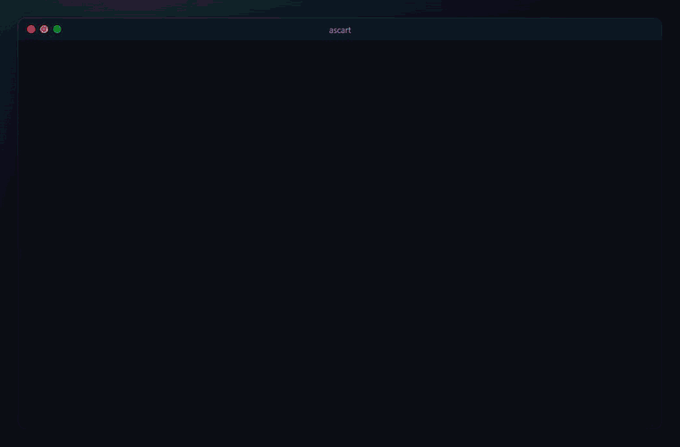
</div>

| Key | |
| --- | --- |
| `↑` `↓` | pick a setting |
| `←` `→` or `space` | change it (hold `shift` for bigger steps) |
| `enter` | type a value, or edit your own character set |
| `o` · `s` · `c` | open a file · save as `.ans`, `.txt` or `.html` · copy as text |
| `v` | switch between the art and the original picture |
| `p` · `,` `.` | play or pause · previous or next frame |
| `tab` | move to the preview, which scrolls with the arrows, `pgup` `pgdn` and the mouse wheel |
| `esc` · `r` · `?` · `q` | stop a conversion · reset · help · quit |

<br>

## The command line

<div align="center">
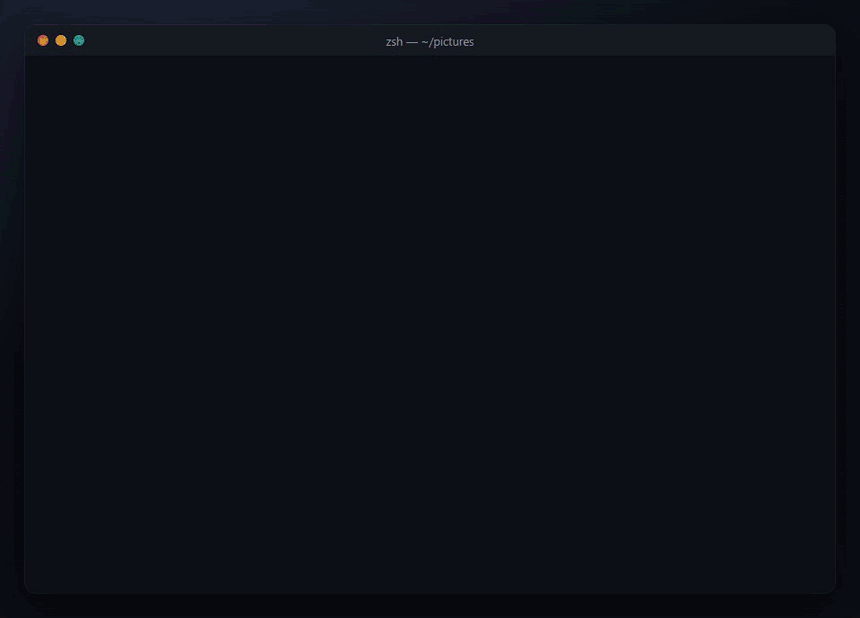
</div>

```bash
ascart convert photo.jpg --width 80                      # print the art
ascart convert photo.jpg --scheme sepia --dither -o a.txt # save it; the extension picks the format
ascart convert logo.png --chars " .oO@" --format html -o logo.html
ascart convert loop.gif --frame 5                        # one frame of an animation
ascart play loop.gif --loops 3                           # play it in place
```

The number of colors follows your terminal (`COLORTERM`, `TERM`, `NO_COLOR`); in a pipe there are none unless you ask with `--colors`. Mistakes exit with code 2 and a one-line message, failures with 1, so it behaves in scripts. All flags are in [cli/README.md](cli/README.md).

<div align="center">
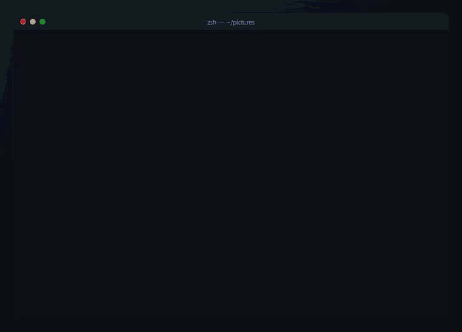
</div>

> **Tip for dark terminals.** The built-in sets run from dark to light the way ink on paper does, so bright areas get thin characters. For light on dark, write your own ramp from darkest to lightest: `--chars " .:-=+*#%@"`. For halftone, add `--invert`.

<br>

## Install

### Terminal app and command line

With [Go](https://go.dev/dl/) 1.26 or newer:

```bash
go install github.com/Oblutack/AscArt/cli/cmd/ascart@latest
```

Or download an archive for your system from the [releases page](https://github.com/Oblutack/AscArt/releases) (Windows, macOS and Linux; Intel and ARM) and put `ascart` on your `PATH`. Videos need [ffmpeg](https://ffmpeg.org) on your `PATH`, or set `ASCART_FFMPEG`.

### Desktop app

Prebuilt packages are attached to releases. The latest published release, v1.0.0, only has Windows and is older than everything on this page, so for now **build it from source**. It takes a couple of minutes:

```bash
git clone https://github.com/Oblutack/AscArt.git
cd AscArt
npm install

cd python
python -m venv venv
venv\Scripts\activate          # macOS/Linux: source venv/bin/activate
pip install -r requirements.txt
cd ..

npm start                      # the app, with hot reload
```

You need Python 3.12+, Node.js 18+ and Git. In development the app starts the Python backend from `ASCART_PYTHON`, then `python/venv`, then `python` on your `PATH`.

<details>
<summary><b>Build an installer</b></summary>

<br>

Build from the `python/venv` above, not a global Python: the engine bundles whatever versions are installed, and mismatched onnxruntime, scipy or opencv packages can leave background removal broken in the packaged app.

```bash
npm run build
```

This builds the React app, freezes the Python backend into `python/dist/engine` with PyInstaller, and packages everything with electron-builder for the system you run it on (an installer and 7z on Windows, a dmg and zip on macOS, an AppImage on Linux). The steps are also available on their own as `npm run react-build`, `npm run build:engine` and `npm run dist`.

**Releases.** Push a tag such as `v1.2.0` and the Release workflow builds the Windows, macOS (Apple Silicon) and Linux packages and the six `ascart` binaries on GitHub's runners, checks that each bundled engine answers a ping, and attaches everything to a release. You can also start it by hand from the Actions tab to build without releasing. Builds are unsigned unless you add `CSC_LINK` and `CSC_KEY_PASSWORD` as repository secrets, so Windows SmartScreen and macOS Gatekeeper will warn on first run.

</details>

<br>

## How it works

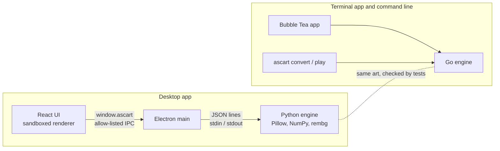

* **The desktop app** is a React UI in a sandboxed Electron window. It has no Node access and talks to the main process only through a small `window.ascart` API from a preload script. The main process runs the Python engine as a subprocess and exchanges JSON lines with it. A conversion can be cancelled cooperatively, so Stop doesn't kill the process.
* **The terminal app** has its own engine in Go, so it needs nothing else installed. `internal/engine` converts pictures, GIFs and video frames; `internal/cli` and `internal/tui` are thin layers on top. The interactive app is a Bubble Tea model that takes its loader, converter and file writer as injected functions, which is what lets the tests drive it without a terminal.
* **Two engines, one result.** `cli/testdata/make_golden.py` runs the Python engine on small pictures and the Go tests compare against what it wrote: identical for flat pictures across every scheme, set and adjustment; 99.5–100% of characters on smooth gradients and 92.5% on hard stripe edges (Python resizes with Lanczos, Go averages the area); the same size and amount of black for halftone. Background removal exists only in the desktop app because Go has no equivalent of rembg.
* **Compact output.** Neighbouring characters with the same rounded color share one `<span>`, which keeps results and history small.

Full message reference: [BACKEND_DOCS.md](BACKEND_DOCS.md).

<br>

## Quality

| | Tests | What they cover |
| --- | --- | --- |
| **UI** | 272 (Vitest, Testing Library) | components, hooks, shortcuts, error states |
| **Electron helpers** | 11 (`node --test`) | text, HTML and ANSI export |
| **End to end** | 35 (Playwright) | the real Electron app with the real Python backend: converting, GIFs, video, webcam with a fake camera, saving, history, cancelling, the security lockdown |
| **Python** | 142 (pytest) | conversion, GIFs, video, cancelling, history, backend commands |
| **Go** | about 140 | engine, parity with Python, command line, the Bubble Tea app, one real program run |

GitHub Actions runs all of it on every push and pull request: ESLint, Prettier, ruff and the type check (TypeScript over the JavaScript, via JSDoc), plus the Go suite on Linux (with the race detector), macOS and Windows. Releases were verified on real runners for all three systems.

**Security.** Context isolation, the sandbox and a strict Content-Security-Policy are on; navigation, new windows and webviews are blocked; permissions are denied except video for the camera; IPC commands are allow-listed; and Electron fuses switch off `RunAsNode`, the inspector flags and loading from outside the asar. Details and how to report a problem: [SECURITY.md](SECURITY.md).

```bash
npm run lint && npm run typecheck && npm test    # UI and Electron helpers
npm run test:e2e                                 # builds the UI, then drives the real app
cd python && python -m pytest && python -m ruff check
cd cli && go vet ./... && go test ./...
```

<br>

## Project structure

```
AscArt/
├── electron/        Main process, preload API, export helpers, the widget window
├── src/             The React UI: components, hooks, styles, tests
├── python/          The Python engine: conversion, GIF and video, history, tests, PyInstaller recipe
├── cli/             ascart for the terminal
│   ├── cmd/ascart/      main
│   ├── internal/engine/ conversion, rendering, GIF and video loading
│   ├── internal/cli/    convert, play, flags
│   ├── internal/tui/    the Bubble Tea app
│   └── testdata/        test pictures and what the Python engine makes of them
├── e2e/             Playwright end-to-end tests and fixtures
├── docs/media/      The pictures and recordings on this page, and how they were made
├── assets/          App icon and the script that draws it
├── scripts/         build-engine.js
└── BACKEND_DOCS.md  Electron <-> Python message reference
```

<br>

## Configuration

<details>
<summary><b>Where your data lives</b></summary>

<br>

History is stored in Electron's per-user data folder (on Windows `%APPDATA%\asc-art\output\history\`), next to `settings.json`: a small `index.json` with a thumbnail of every entry, plus one file per entry that is read when you open it. A history from an older version (`history.json`) is converted on first start and kept as `history.json.migrated`. Set `ASCART_DATA_DIR` to put it somewhere else when running the backend by hand. The entry limit (50) is `MAX_HISTORY_ENTRIES` in `python/core/file_handler.py`.

Other environment variables: `ASCART_PYTHON` (which Python to use in development), `ASCART_FFMPEG` (which ffmpeg to use), and for tests `ASCART_USE_BUILD`, `ASCART_SKIP_LEGACY_IMPORT` and `ASCART_FAKE_CAMERA`.

</details>

<details>
<summary><b>Adding a character set</b></summary>

<br>

In the apps you can write your own set from darkest to lightest (2 to 100 single-width characters). To add a named one, edit `CHARSETS` in `python/core/charsets.py`, the Go equivalent in `cli/internal/engine/charsets.go`, and the Style dropdown in `src/components/Generator/WidthPanel.jsx`:

```python
CHARSETS = {
    'detailed': '@%#*+=-:. ',
    'blocks': '█▓▒░ ',
}
```

`standard` and `simple` still work as aliases for `detailed` and `blocks`, so older history entries load.

</details>

<details>
<summary><b>Colors and theme</b></summary>

<br>

The desktop app's colors are CSS variables in the `:root` block at the top of `src/styles/main.css`. The `-rgb` twins (for example `--pale-slate-2-rgb`) exist so translucent colors can use `rgba(var(--pale-slate-2-rgb), 0.3)`.

</details>

<br>

## Troubleshooting

<details>
<summary><b>The app can't find Python</b></summary>

<br>

Point it at one before starting:

```bash
# Windows (PowerShell)
$env:ASCART_PYTHON = "C:\path\to\python.exe"; npm start

# macOS / Linux
ASCART_PYTHON=/path/to/python npm start
```

Otherwise create the `python/venv` described above, or make sure `python` is on your PATH.

</details>

<details>
<summary><b>Port 3000 is already in use</b></summary>

<br>

```bash
# Windows
netstat -ano | findstr :3000
taskkill /PID <process_id> /F
```

</details>

<details>
<summary><b>Background removal does nothing</b></summary>

<br>

rembg downloads its model (about 200 MB) the first time you use it. You need an internet connection, free disk space and write access to the Python package directory.

</details>

<details>
<summary><b>"needs ffmpeg" when opening a video</b></summary>

<br>

Install [ffmpeg](https://ffmpeg.org/download.html) and make sure `ffmpeg` runs in a terminal, or set `ASCART_FFMPEG` to its full path.

</details>

<br>

## Limitations and what's next

* Desktop builds are unsigned until a certificate is added, and Intel Macs have no desktop build yet (the terminal binary has one).
* Background removal is desktop-only.
* Widgets can't be minimized to the taskbar: they are desktop overlays by design.
* Very large GIFs (500+ frames) take a while to load in widgets.
* Next: batch conversion, widget opacity and saved widget layouts.

<br>

## Contributing

Issues and pull requests are welcome. Run the checks in [Quality](#quality) before you push; CI runs the same ones. The pictures and recordings in this README were made from the real programs, see [docs/media](docs/media/README.md) if you want to redo them.

<br>

## License and credits

[MIT](LICENSE). Thanks to [rembg](https://github.com/danielgatis/rembg) for background removal, [Pillow](https://python-pillow.org/) and [NumPy](https://numpy.org/) for the Python engine, [Bubble Tea](https://github.com/charmbracelet/bubbletea) and the other Charm libraries for the terminal app, and the Electron and React communities. The Earth photo in the examples is from NASA's Apollo 17 mission and is in the public domain.
